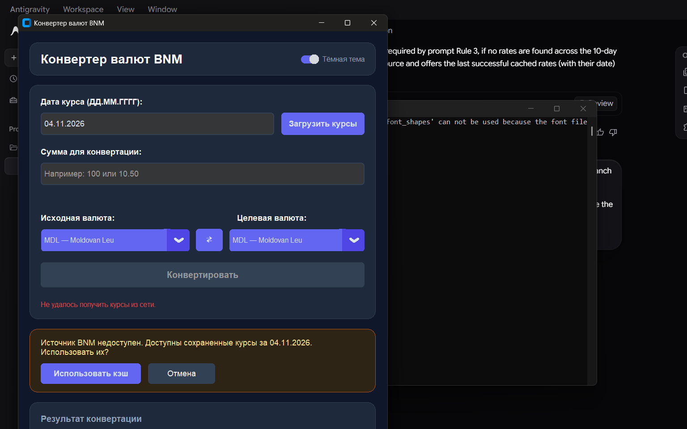

# Desktop Currency Converter

A modern desktop application built with Python and CustomTkinter that fetches official exchange rates from the National Bank of Moldova (BNM) and performs precise Decimal-based currency conversions.



## Features

- **Official BNM Rates**: Fetches official exchange rates directly from the National Bank of Moldova XML API (`https://www.bnm.md/en/official_exchange_rates`).
- **Precision Monetary Arithmetic**: Uses Python's `Decimal` type for all conversions to guarantee financial accuracy and prevent binary floating-point rounding errors.
- **Reference Currency (MDL)**: Seamlessly supports Moldovan Leu (MDL) as the baseline currency with a fixed rate of 1; conversions between foreign currencies are calculated via cross rates through MDL.
- **Same-Currency Conversions**: Handles identical source and target currencies gracefully, returning the original amount with an effective rate of 1.
- **Directional Rates & Attribution**: Displays exchange rates in both directions (`1 A = x B` and `1 B = y A`) along with effective rate date and source attribution (BNM).
- **Automatic 10-Day Date Fallback**: If rates are missing or unpublished for the selected date (e.g. weekends or bank holidays), the application automatically steps backward day-by-day (up to 10 days) to the latest available rate snapshot and informs the user.
- **Offline-First Resilience**: Automatically persists the last successfully received rate snapshot to local disk. When the network is unavailable or requests fail, the user is offered the cached rates along with their original date.
- **Strict Input Validation**: Validates amounts strictly—only positive amounts with up to two decimal places (accepting both `.` and `,` as decimal separators) are allowed; letters, zero, negatives, grouping spaces, and scientific notation are rejected with adjacent Russian-language error messages.
- **Modern Responsive UI**: Built with CustomTkinter featuring rounded cards, a custom indigo accent color (`#4F46E5` / `#6366F1`), light/dark mode switching, background network threading with an active loading indicator, currency swap button, clear disabled button states, and stale result protection. All user interface text is presented in Russian.

## Prerequisites

- Windows 10/11
- Python 3.11 or newer

## Installation & Setup

1. Clone the repository:
   ```powershell
   git clone <repo-url>
   cd currency-converter
   ```

2. Create and activate a virtual environment:
   ```powershell
   py -3.11 -m venv .venv
   .\.venv\Scripts\Activate.ps1
   ```

3. Install required dependencies:
   ```powershell
   pip install -r requirements.txt
   ```

## Running the Application

To launch the desktop currency converter:

```powershell
.\.venv\Scripts\python.exe main.py
```

Or, if the virtual environment is already activated:

```powershell
python main.py
```

## Running Tests

Run the full pytest suite with:

```powershell
.\.venv\Scripts\python.exe -m pytest -v
```

Or, with the virtual environment activated:

```powershell
python -m pytest -v
```

All non-UI business logic is thoroughly covered by unit and integration tests using mocked HTTP responses and temporary caches, requiring no live network connection.

## Cache Location

The last successful rate snapshot is saved locally as an atomic JSON file at:
```text
%APPDATA%\CurrencyConverter\cache.json
```
(typically `C:\Users\<Username>\AppData\Roaming\CurrencyConverter\cache.json`).

## Reference Rate Caveat

Rates obtained from the National Bank of Moldova are **official reference exchange rates**. Commercial exchange bureaus and banks set their own retail rates, which may differ from the official BNM rates displayed here.
